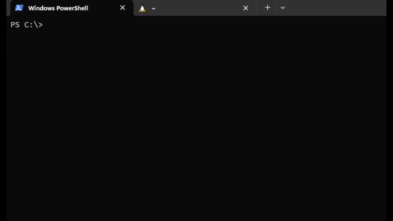
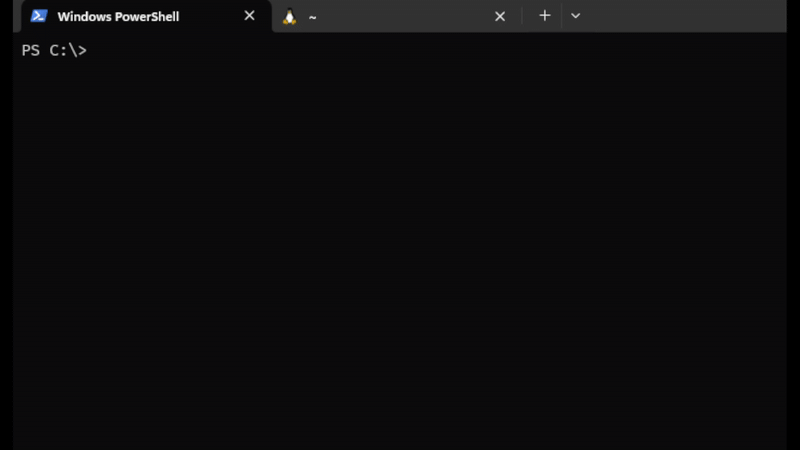
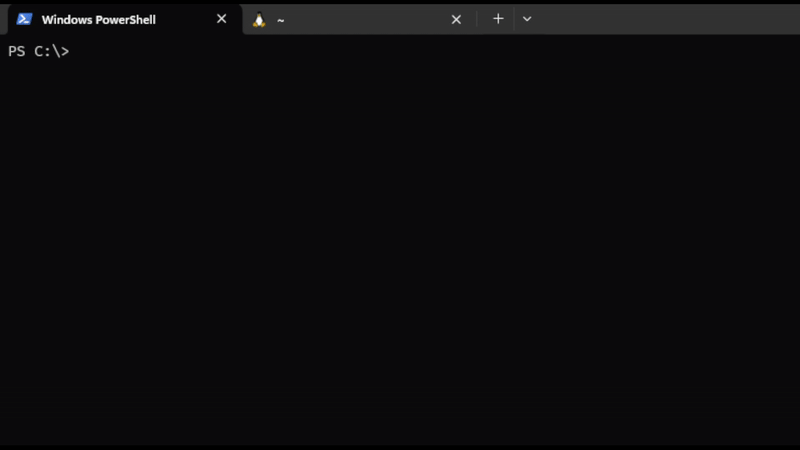
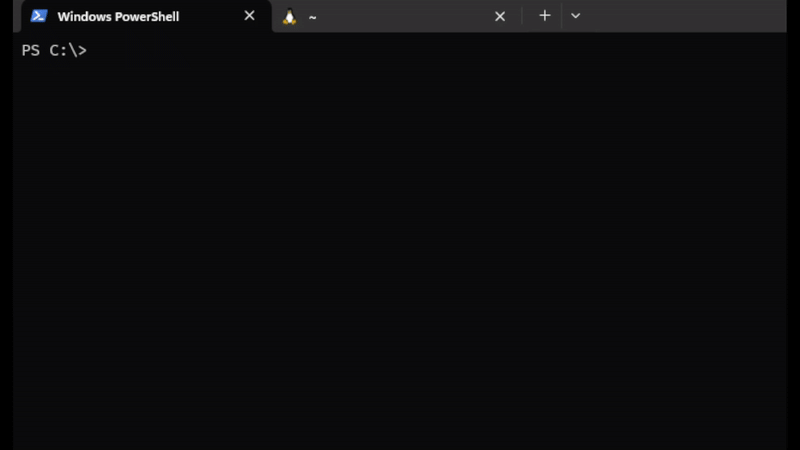
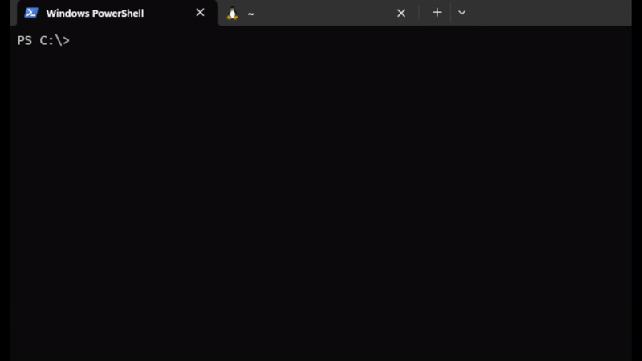
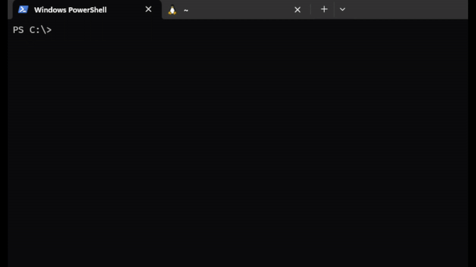

# `IOExtender Control Center (IOCC)`

<p align=center>
  <a href="https://github.com/Thiapalm/iocc"></a>
  <a href="http://www.apache.org/licenses/LICENSE-2.0"></a>
 <a href="http://opensource.org/licenses/MIT"></a>
</p>

## Description
This software was developed to work in conjunction with USBIOExtender hardware (https://github.com/Thiapalm/usbioextender). This is a command line tool for communicating with I2C devices connected to the board.
The USBIOExtender board has an I2C connector and a number of IO Pins that can be configured via this software to be used straight from the command line, without the need to install any driver.

## Features
- Run from the command line
- Scan the I2C Bus for connected devices (each address is probed with a 1 byte read, which some devices such as EEPROMs or ADCs may treat as an operation)
- Configure USBIOExtender IO Pins
- Communicate with any I2C device connected to USBIOExtender via Read/Write operations
- Read one or more bytes at the same time (`--expected`)
- Write one or more bytes (use space to separate bytes)
- Show board Status
- Can be extended via plugins
- Can configure default communication parameters via a simple config.yaml file
- Plugins can also use the same config.yaml file
- Interactive terminal UI (`iocc tui`): bus scan, register editor, plugin panels and log
- Plugins add panels and actions through a JSON manifest, with no change or recompilation of iocc
- Streaming panels (one update per stdout line) and pinning to keep monitoring visible while other plugins run
- Pin several panels (even from the same plugin), reorder them, scroll/zoom a panel and record the pinned metrics to CSV
- Chart panels (`kind: "chart"`) plot one metric over the 120-sample history, with min/max and a compact sparkline fallback (`m` cycles between the metrics of the sample, `min`/`max` fix the axis for discrete signals)
- Device broker (`IOCC_SOCKET`) so plugins can share the MCP2221 with the TUI at the same time
- Plugin actions can save their settings in `config.yaml`, so the next run and the next prompt start with the new value
- `iocc --via-tui` runs the native `status`/`scan`/`read`/`write` through a running TUI, and the `iocc-bus` crate gives plugins a ready made broker client

## Version Revision

1.2.0 - Broker and panel tooling
- Pin any panel (several from the same plugin), reorder the watches and remove one with `x`
- Scroll the *Watches* column, zoom a panel and scroll its content
- Chart panels (`kind: "chart"`) plot a metric over the history, with min/max and a compact fallback
- Record the pinned `metrics` panels to CSV (`g`, `IOCC_RECORD` overrides the path)
- Device broker gains `ping`, `status`, `scan`, `gpio_read` and `gpio_write`
- New `iocc-bus` crate so plugins use the broker without reimplementing the protocol
- `iocc --via-tui` runs `status`/`scan`/`read`/`write` through a running TUI (direct access remains the default)

1.1.0 - Terminal UI
- New interactive terminal UI (`iocc tui`) with scan, register editor, plugin panels and log
- Plugin manifest protocol (`--iocc-manifest`): views (`text`/`table`/`metrics`), streaming views and actions with typed arguments
- Pinning panels to the *Watches* column and a Unix device broker (`IOCC_SOCKET`) that lets plugins share the bus while the TUI keeps it open
- Runnable demos without hardware: `examples/iocc-demo`, `examples/iocc-wave` and `examples/tui-demo.sh`
- Tests now run without hardware (`cargo test`)

1.0.1
- Can be installed with `cargo install`
- `config.yaml` is now created automatically on first run in the system config folder
- New `setup-udev` command to grant USB access on Linux
- Plugins now receive `IOCC_HOST` and `IOCC_CONFIG`; plugin contract documented ("Writing plugins")
- Plugin detection and execution rewritten; plugin name validation
- General code fixes and refactoring
- Added `install.sh` installer

1.0.0 - First Version

## Installation
The `config.yaml` file is created automatically on first run in the system config folder (Linux: `~/.config/iocc/config.yaml`, macOS: `~/Library/Application Support/iocc/`, Windows: `%APPDATA%\iocc\`). Plugins are executables named `iocc-<name>`: they are searched next to the `iocc` binary first, then in every absolute `PATH` entry.

### Prerequisites
- This software requires USBIOExtender hardware to work properly (https://github.com/Thiapalm/usbioextender).
- To build from source: Rust 1.88 or newer (https://www.rust-lang.org/).

### Install with the script (recommended)
```bash
git clone https://github.com/thiapalm/iocc.git
cd iocc
./install.sh
```

It builds in release mode, installs `iocc` (default `~/.local/bin`), copies any `iocc-*` plugin built in `target/release`, and installs the Linux udev rule. Use `--prefix DIR` for another folder, `--no-udev` to skip the rule, or `--uninstall` to remove the binary and plugins.

Make sure the install folder is in `PATH` (the script prints a reminder) and, on Linux, unplug and replug the board after the udev step.

### Build it yourself
```bash
cargo build --release
cargo install --path .   # or copy target/release/iocc to a folder in PATH
```

Plugins must be in the same folder as `iocc` or in `PATH`; `iocc --help` lists the ones found under *Detected Plugins*.

### Linux USB permissions
By default only root can access the USBIOExtender (MCP2221, VID `04d8`, PID `00dd`). Without a udev rule, iocc fails with `USB error: Access denied (insufficient permissions)`. Install the rule once (after `cargo install` or `cargo build`):

```bash
sudo $(which iocc) setup-udev
```

This writes `/etc/udev/rules.d/60-mcp2221.rules` and reloads udev. Then unplug and replug the board. The rule uses `TAG+="uaccess"`, which grants access to the user logged in locally on the machine. It does not apply to SSH sessions or system services; for those, edit the file and use `GROUP="plugdev", MODE="0660"` (and add the user to that group).

## Usage
Instructions on how to use the software.

### Usage Examples

- Fetch device Status:


- Scan for connected devices:


- Reading from any connected device:


- Writing to any connected device:


- Get Help:


- Get Help on commands:


- Get Help on Plugins:


### Terminal UI

```bash
iocc tui
```

The TUI needs a real terminal (through a pipe or CI it fails with `No such device or address`). It has four tabs, switched with `1`-`4` or `Tab`:

| Tab | What it does |
|---|---|
| Scan | probes the bus; `Enter` opens an address in Registers, `s` rescans, `i` shows device info |
| Registers | reads and writes bytes, `p` enables polling, `m` toggles read-only |
| Plugins | lists the plugins found, with their panels and actions (`R` reloads the manifests) |
| Log | host messages |

On the Plugins tab, the panels declared by the plugin are drawn on the right; `Enter`/`→` opens the actions and `Enter` runs the selected one (`Esc` goes back). `[`/`]` selects a panel (marked with `▸`), `p` pins or unpins it and `x` unpins it. Pinned panels move to the *Watches* column and stay visible on every tab, including while another plugin runs. A plugin can pin several of its panels: `,`/`.` reorders the selected watch, `P` unpins everything and `PageUp`/`PageDown` scrolls the column when the panels do not fit. `z` zooms the selected panel, `Ctrl+↑`/`Ctrl+↓` scrolls it and `g` records the pinned `metrics` panels to CSV (the file path is logged; `IOCC_RECORD` overrides it).

Plugins that declare `"device": "shared"` receive `IOCC_SOCKET` and share the MCP2221 with the TUI through a small broker, so a streaming panel can keep sampling while an action from another plugin uses the bus. Actions that open the device themselves (the default) pause the watches while they run. See [docs/tui-plugins.md](docs/tui-plugins.md) for the protocol and the full key list.

The socket lives in `$XDG_RUNTIME_DIR/iocc.sock` (or at the path given by `IOCC_SOCKET`) and is created with mode `0600`. While the TUI is open, another terminal can use any plugin that speaks the protocol through it, and the native commands can opt into the broker with `--via-tui`:

```bash
IOCC_SOCKET=/run/user/1000/iocc.sock iocc powmon read --json

iocc --via-tui status
iocc --via-tui scan
iocc --via-tui read -a 4A -r 02 -e 2
```

Without `--via-tui` the native `iocc status`/`scan`/`read`/`write` commands keep opening the device directly, exactly as before. `--via-tui` does not apply to plugins (they get `IOCC_SOCKET` for `shared` views/actions) nor to `iocc tui`. The broker speaks the same protocol on Unix only.

No hardware is needed to try it. The repository ships two demo plugins:

```bash
cargo build
./examples/tui-demo.sh
```

`examples/iocc-demo` covers the manifest basics; `examples/iocc-wave` streams simulated signals and is made for pinning two panels at once, running a shared action (watches stay live) and an exclusive one (watches show `paused` and restart). See [examples/README.md](examples/README.md) for the walkthrough.

## Writing plugins
Plugins are built separately from iocc and cannot run on their own: they are always started by iocc (e.g. `iocc powmon status`). iocc itself works without any plugin. The contract between them is:

- **Name and location:** the executable must be named `iocc-<name>` (`.exe` on Windows, name restricted to letters, digits, `-` and `_`) and live in the same folder as `iocc` or in the `PATH`. `iocc <name> <args>` runs it with the remaining arguments and returns its exit code.
- **Configuration:** the shared file `config.yaml` lives in the system config folder (`<config dir>/iocc/config.yaml`, e.g. `~/.config/iocc/config.yaml` on Linux). Each plugin reads its own top-level section (e.g. `powmon:`) and should fall back to its own defaults if the section is missing. iocc only reads the `iocc:` section and creates the file on first run.
- **Environment:** iocc sets `IOCC_HOST=1` and `IOCC_CONFIG=<path to config.yaml>` for the plugin. From the TUI it also sets `IOCC_TUI=1`, plus `IOCC_SOCKET` for views and actions declared as `shared`. Plugins should use `IOCC_CONFIG` instead of computing the path, and refuse to run (asking the user to use `iocc <name>`) when `IOCC_HOST` is not set.
- **Device access:** from the command line iocc does not open the USBIOExtender when running a plugin, so the plugin opens the MCP2221 itself. The TUI keeps the device open instead: plugins default to `exclusive` (the chip is released, the plugin opens it, streams pause and restart afterwards) and can opt into `shared`, where they talk to the broker through `IOCC_SOCKET` while the TUI serializes the transactions.
- **Broker client:** the [`iocc-bus`](iocc-bus) crate wraps the JSON protocol (`ping`, `status`, `scan`, `info`, `read`, `write`, `gpio_read`, `gpio_write`), so a `shared` plugin does not have to parse the socket by hand. Until it is published, depend on it from this repository (`path` or `git`).
- **Starter template:** [`templates/iocc-plugin`](templates/iocc-plugin) is a standalone Rust crate with the manifest, the direct/broker transport and config persistence already wired and tested. Copy it with `templates/new-plugin.sh <name> <dir>` (or by hand) and replace the imaginary register map in `src/device.rs`.
- **Errors:** write errors to `stderr` and exit with a non-zero code.
- **Terminal UI (optional):** `iocc tui` opens an interactive interface (bus scan, register editor, plugins, log). A plugin adds its own panels and actions by answering `iocc-<name> --iocc-manifest` with a JSON description, with no change or recompilation of iocc. Streaming panels can be pinned (`p`) to stay visible while other plugins run; plugins that declare `"device": "shared"` use the TUI broker (`IOCC_SOCKET`) so monitoring and actions can share the bus. See [docs/tui-plugins.md](docs/tui-plugins.md); `examples/iocc-demo` and `examples/iocc-wave` are runnable demos (no hardware needed) — start them with `./examples/tui-demo.sh`.

## Contributing
How to contribute to the project? How to open pull requests?

1. Fork the repository.
2. Create a branch for your changes (`git checkout -b feature/AmazingFeature`).
3. Make the changes and create commits in this branch.
4. Push your changes using `git push origin feature/AmazingFeature`.
5. Open a pull request.

Unless you explicitly state otherwise, any contribution intentionally submitted
for inclusion in the work by you, as defined in the Apache-2.0 license, shall be
dual licensed as above, without any additional terms or conditions.

## License

Licensed under either of

- Apache License, Version 2.0 ([LICENSE-APACHE](LICENSE-APACHE) or
  http://www.apache.org/licenses/LICENSE-2.0)

- MIT license ([LICENSE-MIT](LICENSE-MIT) or http://opensource.org/licenses/MIT)

at your option.

## Contact
Contact information in case of questions or issues.
palmieri@adastra.aleeas.com